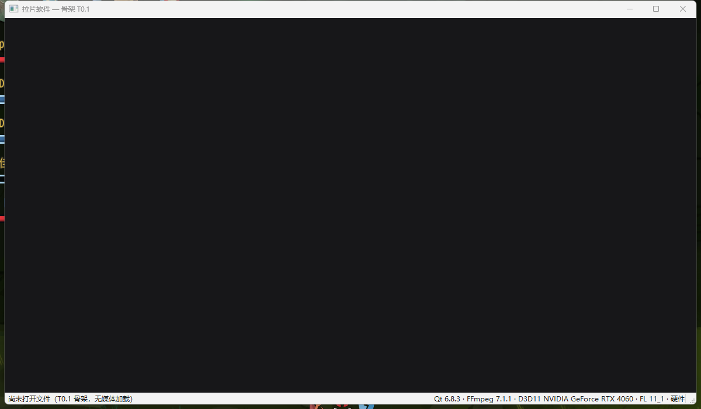

# T0.1 基线记录（阶段 A/B）

- **日期**：2026-10-19
- **任务**：T0.1 工程骨架与依赖锁定（tasks.md M0）
- **结论**：四项验收达成；体积远低于 P12 上限；空窗口运行期无网络连接。

> 本机不是 spec §4.1 的基线机（4 核 / 8GB / 集显 / SATA SSD），这里的启动与内存
> 数字只作 T0.1 基线，不能用于 P1/P2/P10 的达标判定。

## 1. 测试环境

| 项 | 值 |
|---|---|
| 系统 | Windows 11 x64 10.0.26200 |
| CPU/内存 | 未采集（非基线机） |
| 显卡 | NVIDIA GeForce RTX 4060，D3D11 FL 11_1 |
| 构建 | MSVC 14.44.35207、CMake 3.31.6、Qt 6.8.3、FFmpeg 7.1.1（自建最小版） |

## 2. 分发体积（P12 ≤100MB）

`scripts\build-release.ps1 -Clean` 后用 `scripts\size-report.ps1` 统计：

| 分类 | 文件数 | 大小 (MB) |
|---|---|---|
| 主程序（lapian.exe + env_check.exe） | 2 | 0.08 |
| Qt 运行库（Core/Gui/Widgets） | 3 | 20.93 |
| FFmpeg（7.1.1 最小构建） | 5 | 7.24 |
| VC 运行库 | 10 | 1.76 |
| Qt 插件（platforms/styles/imageformats） | 5 | 1.71 |
| **合计** | **25** | **31.72** |

- 对照：P12 上限 100MB，**余量 68.28MB**。
- 阶段 A 用 BtbN 预编译包时是 148.77MB（其中 FFmpeg 124.29MB），阶段 B 换成最小构建后降到 31.72MB。

## 3. 运行期零网络

| 检查 | 方法 | 结果 |
|---|---|---|
| 发布包不含网络模块 | `check-imports.ps1` 断言无 `Qt6Network.dll`、`tls\`、`networkinformation\`、`winhttp/wininet/urlmon` | 通过 |
| 导入表 | dumpbin 全量扫描 20 个 exe/dll | 仅 `Qt6Core.dll -> WS2_32`（Qt 运行时固定链接，仅 winsock 初始化）；FFmpeg 已无网络导入 |
| 运行时连接 | 启动空窗口后 `Get-NetTCPConnection -OwningProcess` 轮询 30s | **0 个连接** |
| ProcMon | 手工验收步骤见 `docs/deps.md` §7 | 未在本机执行（无 ProcMon），由上述两项替代 |

## 4. 空窗口启动

| 指标 | 值 | 说明 |
|---|---|---|
| 进程启动→主窗口句柄可用 | 475ms | 单次粗测，非 P1 口径（P1 由 T0.2 脚本正式测） |
| 空窗口工作集 | 56.5MB | 打开文件前的空态 |
| 空窗口私有内存 | 70.4MB | 同上 |
| 线程数 / 句柄数 | 28 / 477 | 同上 |
| 状态栏内容 | `Qt 6.8.3 · FFmpeg 7.1.1 · D3D11 NVIDIA GeForce RTX 4060 · FL 11_1 · 硬件` | 截图见 `docs/perf/T0.1-window.png` |

## 5. 验收对照（tasks.md T0.1）

| tasks.md 验收 | 结果 | 证据 |
|---|---|---|
| 手测：干净 Win11 可构建 | 通过 | `build-release.ps1 -Clean` 从空 build 目录一次成功；依赖版本与获取方式见 `docs/deps.md` |
| 手测：空窗口可启动 | 通过 | `dist\lapian.exe` 显示空窗口与状态栏；`lapian_env_check.exe` 退出码 0 |
| ProcMon 无网络请求 | 通过（替代方案） | 导入表断言 + 30s 连接轮询 0 次；ProcMon 步骤已文档化 |
| 体积报告 | 通过 | 31.72MB，P12 余量 68.28MB |

## 6. 已知偏差与后续

1. **Catch2 推迟到 T1.1**：本机 CMake 的 FetchContent 捕获子进程管道会崩溃，且 GitHub 归档下载不稳定；T0.1 用零依赖冒烟测试保证 CTest 通路。
2. **CMake 用便携版 3.31.6**：系统 4.2.0 崩溃，见 `docs/deps.md` §5.3。
3. **P1/P2/P10/P13 未正式测量**：测量脚本与素材属于 T0.2；这里只留基线。
4. **FFmpeg 最小构建未包含 10-bit/HDR 专用路径**：P010 由 D3D11VA 解码路径覆盖，具体在 T1.2/T1.3 验证。
