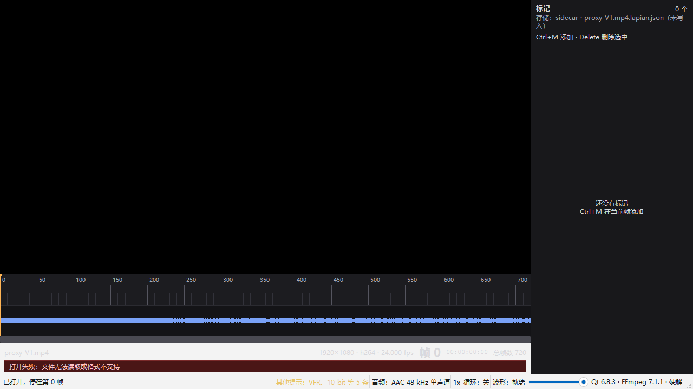
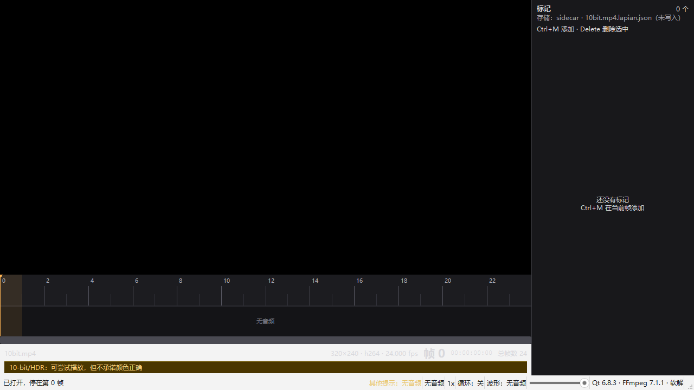
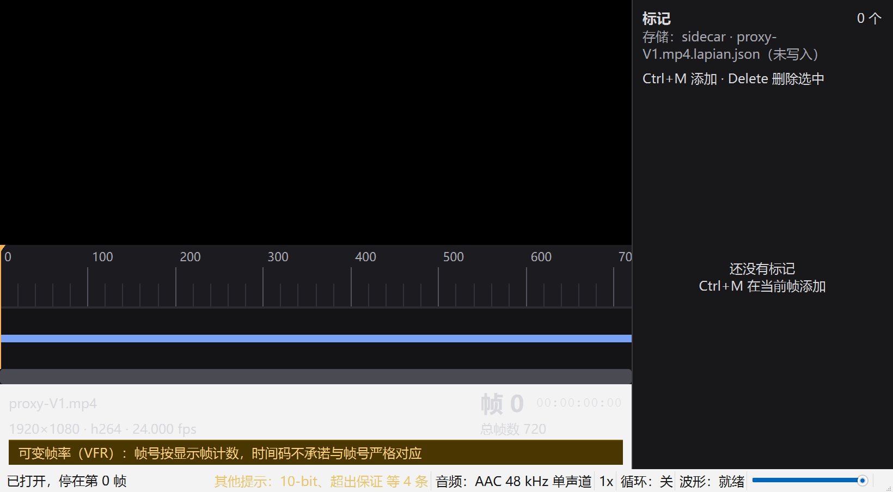

# T6.5 状态横幅测量记录（2026-10-20）

> 验收口径：[spec.md](../spec.md) §3.1 F1-A4/F1-A5、§3.2 F2-A7、§4.2 支持范围与
> “超出范围的行为”、§4.4 稳定性；任务：[tasks.md](../tasks.md) T6.5。
> 本文件只记录 T6.5 的实现口径、自动化证据与开发机数字，不作为 P1–P14 或基线机结论。

## 1. 结论

- 六类提示（错误、VFR、10-bit、超出保证范围、总帧扫描中、无音频）已接入统一状态模型；
  InfoBar 任意时刻只有一个横幅，其余进状态栏常驻提示标签。
- 横幅在 InfoBar 内参与纵向布局：出现时 InfoBar 增高、时间轴/画面按布局让位，
  不覆盖时间轴、帧号、播放/音量/循环控件。
- `ctest` **19/19**（14.20s，新增 `lapian_status_notice_test` 69 项断言）。
- `--banner-test` 在 100% 与 200% 各 **74 项检查、0 失败**；内部再压到 820 宽窄窗。
- `--dpi-test` 100/150/200% 各 9 项、0 失败（T6.4 回归仍通过）。
- `dist` **32.43MB / 25 文件**（P12 上限 100MB 内）。

## 2. 优先级与来源

同一时刻只显示最高优先级的一条；其余按优先级排进状态栏（最多显示 2 个标签 +
“等 N 条”，tooltip 列全部）。

| 优先级 | 提示 | 来源 | 说明 |
|---|---|---|---|
| 5 | 错误 | `OpenFile` 失败 → `InfoBar::SetError` | V8/F1-A5；保留旧画面，下一次成功打开清除 |
| 4 | VFR | `MediaInfo.vfr.suspect` | F2-A7；帧号语义提示，不能被 4K/10-bit 挤掉 |
| 3 | 10-bit | `VideoStreamInfo.bit_depth > 8` | §4.2；不承诺颜色正确 |
| 2 | 超出保证范围 | 像素数/帧率/编码 | §4.2；仍尝试播放，性能不保证 |
| 1 | 总帧扫描中 | `TotalFrameCount::kScanning` | 当前索引同步构建；VFR 时作为 secondary 展示 |
| 0 | 无音频 | `MediaInfo.has_audio == false` | F1-A4；波形不可用，不影响播放/步进/标记/截图 |

**为什么 VFR 排在 10-bit/超出保证之前**：spec F2-A7 要求 VFR 打开时给出提示，而手机
4K VFR 很常见；若“超出保证范围”压过 VFR，VFR 提示只剩状态栏小字。10-bit 是颜色
正确性提示，比性能提示更具体，所以排在超出保证之前。该顺序集中在
`StatusNoticePriority()`，要调整只改一处。

**超出保证范围判定**（`BuildMediaStatusNotices`）：

- 像素数 `width × height > 1920 × 1080`（竖屏 1080×1920 不误报）；
- 帧率 `> 60 + 1e-6`（59.94/60 不误报，60.001 报）；
- 视频编码不是 `h264` / `hevc`；
- 10-bit 单独成条，不再重复计入“超出保证”原因；
- 容器未单独判定：FFmpeg 的 demuxer 名把 MP4/MOV、MKV/WebM 合并，靠容器名会误报；
  VP9/AV1 WebM 已被编码条件覆盖；
- 8-bit HDR 未单独识别（没有存 color transfer/primaries）；10-bit HDR 由 10-bit 提示覆盖。

**错误范围**：T6.5 的“错误”横幅接的是打开失败路径（文件不存在、损坏、不支持）。
运行期跳帧/音频设备/图形错误仍走原有状态栏或 QMessageBox，不升级成常驻横幅。

## 3. 自动化范围

### 3.1 单测（纯 C++）

新测试 `lapian_status_notice_test`（69 项）：

- 1080p H.264 8-bit CFR 有音频 → 无提示；
- 60fps/59.94fps 不报，60.001fps/120fps 报超出；
- 4K/2048×1080 报超出；1080×1920 竖屏不误报；
- VP9 报超出并带编码名；
- 10-bit/12-bit 位深标签、颜色提示；
- 4K 10-bit：10-bit 为横幅、超出保证进状态栏；
- 无音频、扫描中、VFR 的组合与优先级；
- 六类同开：错误为唯一横幅，其余 5 条汇总；
- `ParseStatusNoticeKind` roundtrip、未知名称拒绝、优先级顺序。

### 3.2 `--banner-test`（真实素材 + 合成全量）

命令（100%）：

```powershell
$env:PATH="$PWD\third_party\Qt\6.8.3\msvc2022_64\bin;$env:PATH"
& build\release\bin\lapian.exe --file media\proxy\proxy-V1.mp4 --banner-test --banner-tag 100
```

200% 加 `$env:QT_SCALE_FACTOR='2'` 与 `--dpi-expect-scale 2`。

测试内部按顺序打开：

| 阶段 | 素材 | 期望横幅 | 期望状态栏 |
|---|---|---|---|
| baseline | proxy-V1（1080p H.264 24fps 8-bit 有音频） | 无 | 空 |
| 4K | proxy-V4（3840×2160 H.264 30fps） | 超出保证范围 | 空 |
| VFR | `build/test-media/vfr.mp4`（320×240 18.37fps 无音频） | VFR | 扫描中、无音频 |
| 10-bit | `build/test-media/10bit.mp4`（320×240 yuv420p10le 无音频） | 10-bit | 无音频 |
| 无音频 | `build/test-media/noaudio.mp4` | 无音频 | 空 |
| 错误 | `<file>.t6.5-missing.mp4` | 打开失败 | 空；旧帧保留 |
| 全量（合成） | 六类 | 错误 | VFR、10-bit 等 5 条 |
| 窄窗（合成） | VFR + 4 条 | VFR | 10-bit、超出保证 等 4 条 |

每阶段断言：`banners=1`、横幅在 InfoBar 内、InfoBar 高度/布局无裁切、时间轴可见、
帧号可见、播放可用、音量滑块可见、循环状态可见、状态栏提示可见；并保存截图。
可选素材缺失时打印 `banner_skip`，不阻塞其余检查。

### 3.3 结果

```text
T6.5 banner_summary checks=74 fails=0 dpr=1.00 info_h=75
T6.5 banner_summary checks=74 fails=0 dpr=2.00 info_h=78
```

100%/200% 均 74 项、0 失败；窄窗阶段 `window=820`、`info_narrow=1`。

## 4. 几何与布局

逻辑像素；窗口为 1280×720（100%）/ 928×452（200%）；窄窗为 820 宽。

| 缩放 | 阶段 | InfoBar 宽 | 无横幅 InfoBar 高 | 有横幅 InfoBar 高 | 横幅 |
|---|---|---|---|---|---|
| 100% | 正常 | 980 | 34 | 58 | 964×22，y=32 |
| 100% | 820 窄窗 | 580 | 51 | 75 | 564×22，y=49 |
| 200% | 正常 | 687 | 53 | 78 | 671×23，y=51 |
| 200% | 820 窄窗 | 580 | 53 | 78 | 564×23，y=51 |

- 横幅在 InfoBar 的网格行下方，出现时 InfoBar 增高 24–25px；时间轴固定高度不变，
  画面区按 stretch 收缩（`LayoutProblemsForTest` 仍要求 gfx ≥320×120、timeline ≥72）。
- 200% 正常/窄窗 InfoBar 均为两行网格（T6.4 断点），横幅另占一行；没有覆盖帧号或
  时间码。
- `LayoutProblemsForTest` 新增 `banner-clipped`、`banner-text-clipped`、
  `banner-overlaps-frame`、`banner-overlaps-timeline`、`banner-overlaps-status`；
  `--banner-test` 与 `--dpi-test` 都断言问题清单为空。
- 状态栏新增 `noticeInfo` 常驻标签（最大 240px、右侧省略、tooltip 全量）；
  已加入状态栏重叠/越界检查。

截图（视频区黑是 D3D11 原生 HWND 限制，只用来看布局）：







## 5. 横幅切换成本（开发机探针）

50 次“setText + 样式 + 状态栏更新 + 主布局 activate”，不含 GPU 呈现：

| 缩放 | p50 | p95 | max |
|---|---|---|---|
| 100% | 0.037ms | 0.060ms | 2.487ms（首次） |
| 200% | 0.035ms | 0.059ms | 2.438ms（首次） |

这只是 UI 文本/布局成本，不是 P5 或 P9；不影响“横幅不遮挡控件”的结论。

## 6. 回归

| 回归 | 结果 |
|---|---|
| `ctest` | 19/19，14.20s |
| `--dpi-test` 100/150/200% | 各 9 项、0 失败；200% 正常/全屏/窄窗均无裁切 |
| `--banner-test` 100%/200% | 各 74 项、0 失败 |
| `--fullscreen-test`（V9 + proxy-V4） | 48 项、exit 0；全屏/4K 切换/截图/焦点 |
| `--key-test`（测试.mp4） | 77 项、exit 0；2s 长按 27 帧 |
| `--snapshot-test`（V9 + 1080p 90° `rot-in.mp4`） | 48 项、exit 0；旋转输出 1080×1920 |
| `--note-test` | exit 0；20 次提交 p95 7.03ms |
| `--mark-test` | exit 0；UI p95 5.77ms、画面 p95 31.66ms |
| `--ab-test` / `--loop-test` | exit 0；循环 3 次后 A/B 不变 |
| `--settings-test` + `--settings-expect` | 47+5 项、exit 0；保存 p95 1.170ms |

注：`--snapshot-test` 的旋转夹具用 `build/t5.4-probe/rot-in.mp4`（1920×1080，
display matrix 90°）；不是新的 4K 旋转验收。mark/note 测试前清了 V9 的临时 sidecar，
避免旧测试标记影响断言。

## 7. 缺口 / 不宣称

1. **不是真实显示缩放**：100%/200% 用 `QT_SCALE_FACTOR` 模拟，没有改 Windows
   显示设置，没有 4K 显示器/多显示器/每屏 DPI。
2. **不是真实 VFR 手机素材**：`build/test-media/vfr.mp4` 是 320×240 合成 VFR；
   没有 4K VFR/手机录屏。F2-A7 的正式片单验收仍待 T7.7。
3. **10-bit 只验证到“提示 + 能打开”**：fixture 是 320×240 H.264 10-bit；
   没有 HDR 元数据/广色域，也没有颜色正确性比对（spec 明确不保证）。
4. **超出保证范围规则有边界**：容器未单独判定；8-bit HDR、4:2:2/4:4:4、8K 不细分；
   这些不影响“能识别就提示、不能识别就报错”的主路径，但正式 V4/V5 仍需手测。
5. **“总帧扫描中”当前没有真实异步扫描**：`MediaSession::Open` 同步建索引；
   CFR 不会出现扫描态，VFR 强制扫描态但作为 VFR 的 secondary 展示。
   横幅路径由单测/合成状态覆盖；等 T7.2/后台 index worker 后才会成为真实主状态。
6. **错误横幅只覆盖打开失败**：运行期解码/音频/图形错误仍是状态栏/QMessageBox。
7. **截图视频区黑**：D3D11 原生 HWND 的 `QWidget::grab()` 限制；截图只证明
   InfoBar/状态栏布局，不证明画面渲染。
8. **不是基线机/P1–P14**：74 项检查与 0.037ms 都是开发机（RTX 4060）数字；
   正式性能/2h soak/4K 路径仍归 T7。
